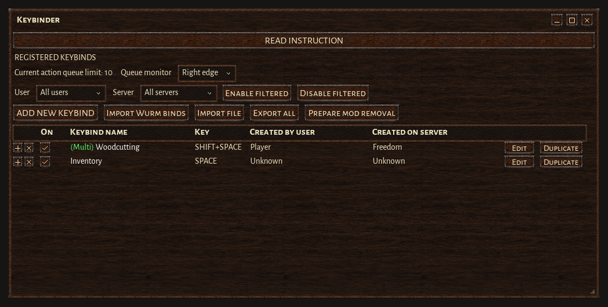
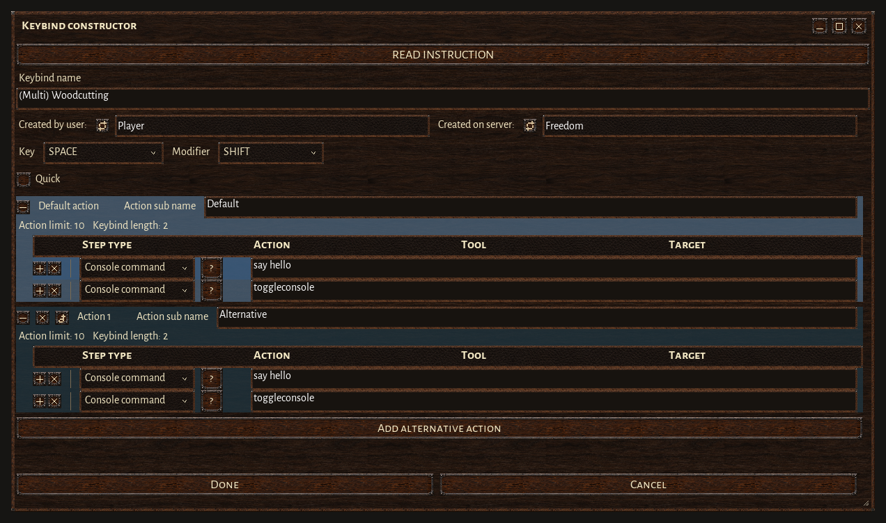
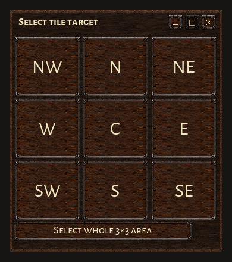
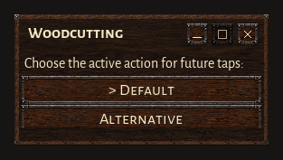
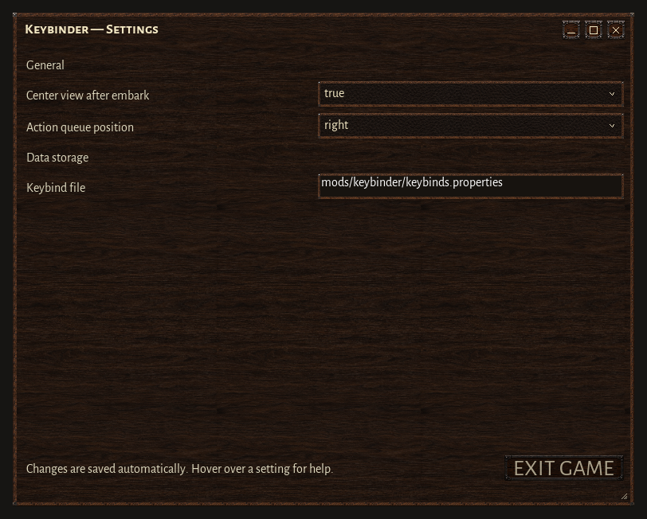

<p align="center">
  
</p>

# Keybinder 1.0.0

Build and manage Wurm Unlimited keybinds from one HUD window. Combine actions and commands, choose tools and targets, and give a single key several useful variants.

[Download Keybinder](https://github.com/chamomilo/wurm-keybinder/releases/latest) · [Forum and support](https://sklotopolis.freeforums.net/thread/8369/new-2026-mod-wurm-keybinder)

## Installation

Requires **Wurm Unlimited** and **Ago's Client Mod Launcher**.

1. Download `keybinder-1.0.0.zip` from the release page.
2. Close the client. Extract the archive into the client directory, merging its `mods` folder.
3. Start Wurm and enable **Keybinder** in **HUD Settings**.

When upgrading, replace the supplied Keybinder files. Saved bindings are separate from the distribution. Keep a backup of `mods/keybinder/keybinds.properties`, its `.accounts` file and your existing `mods/keybinder.properties`. If you configured another data-file path, back up that file instead. Shared settings are stored separately under your user home directory.

The ZIP contains only the mod descriptor, JAR, required HUD artwork, **README.txt** and license notices. The guide images stay in this repository.

Keybinder replaces **Custom Actions**, **Improved Improve** and **i2improve**. Review and import their bindings in Keybinder, then disable the predecessor mods for regular play.

## Manage your bindings

Add, edit, duplicate, reorder and merge bindings. Filter the list by player or server, enable the bindings you need, and import or export them as files. Enabled state is tracked per character.



The **Value Pack** includes eleven starting examples, including a Q Quick menu, an E Multi binding, camera controls and a sprout chain. Examples arrive disabled for review. Set their keys, replace personal item selections and enable the ones you want.

## Create an action sequence

Choose **Add new keybind**, enter a name and capture a key or mouse-wheel chord. Add actions or commands in execution order, select tools and targets, then choose **Done**.



Supported steps and targets include:

- Structured action chains, vanilla key actions and console commands.
- Hovered or selected objects, inventory filters, nearby objects, current ride, tiles and areas.
- Active tools, empty hand, toolbelt slots, equipment slots and portable item selectors.
- **Smart Improve**, with automatic tool and resource selection and client-side chance estimates.
- **Archaeology Identify**, with automatic brush or stone-chisel selection.
- Command catalogs supplied by compatible client mods.
- **Shadow recording**, which observes your ordinary actions and asks you to resolve ambiguous tools or targets before saving.

Search the current client action catalog by name or numeric ID. Unknown server or mod action IDs require explicit acceptance. Tool-free actions show their target directly. **Read instruction** opens the detailed in-game guide.

### Tile targets

Select one tile relative to the player, or the whole 3×3 area. **C** is the current tile. Choosing a target in the editor sends no action.



### Quick and Multi

**Quick:** each key press opens a menu. Clicking a variant runs its sequence immediately. Closing the menu runs nothing.

**Multi:** with Quick unchecked and at least two variants, hold the key for **0.2 seconds** to choose the active variant. Later short taps run that variant. Closing the selector preserves the previous choice. A binding with one variant runs directly.



Each variant has its own steps, tools and targets. Menu selection uses no action queue slots.

## Action queue and feedback

Before execution, Keybinder checks every step against the current tools, targets and action queue. Unavailable steps are skipped for that invocation, with the reason shown in **Event**. Their saved definitions remain available for the next press.

Available steps run in order and fill only free queue slots. Multi-target actions send the portion that fits. Local tool activation uses no queue slots. The queue monitor can sit at either screen edge.

Use `keybinder_list` to print managed bindings to **Event**.

## Import, export and restoration

**Import Wurm binds** reviews eligible custom bindings before changing them. Compatible legacy action commands become structured steps; other commands retain their text. Imports keep backups and verify ownership of the live binding.

Use **Import file** and **Export all** to share managed bindings. **Prepare mod removal** restores imported originals where ownership permits. Keys occupied by foreign bindings are reported as conflicts.

## Settings in Mod updates

Open **Mod updates** and click **Settings** on the **Keybinder** card. Each parameter has explanatory hover help. Valid changes save automatically.



| Setting | Effect | Applies |
| --- | --- | --- |
| Center view after embark | Align the view with the vehicle heading when you take control. | Immediately |
| Action queue position | Place the queue monitor at the left or right screen edge. | Immediately |
| Keybind file | Choose the file used to store keybind definitions. | Next client start |

A saved change to **Keybind file** shows a restart notice. **Continue configuring** keeps the client running; **Exit game** opens Wurm's normal quit confirmation. The active binding file stays unchanged until the next start. Restoring its previous value clears that restart reminder. Changing the path selects a different data file; it does not move your existing bindings into it.

User overrides are stored in `~/.chamomilo/mod-settings/keybinder.properties`, where `~` is your user home directory. They survive replacement of the installation files. Include this file in your configuration backup.

## Shared language and updates

This release embeds **Chamomilo Updater 1.5.0** and **Chamomilo UI 0.4.11**. Compatible Chamomilo mods share one update window and use the newest compatible embedded updater at startup. Failed catalogue logo downloads retry in the background.

Choose **English, Brazilian Portuguese, German or Russian** through the shared language selector in **Mod updates**. Existing Keybinder windows refresh without restarting. Shared settings keep unfinished input and scroll position during a language switch.

**Update**, **Install** and **Download** open the appropriate GitHub release page after a click. Install release ZIPs manually.

## Changes in 1.0.0

- Added Keybinder settings to the shared updater, with immediate camera and queue changes and next-start data-file selection.
- Added automatic settings persistence, validation and restart notices through the complete Updater 1.5.0 module.
- Updated the illustrated guide and retained a compact installation ZIP with a plain-text README.
- Added checks of the actual Keybinder settings controls, callbacks, persistence and startup-only behavior.

## Build from source

Use **JDK 8**, the included Gradle wrapper and the pinned client libraries in `libs/`: `client-patched.jar`, `common.jar`, `javassist.jar` and `modlauncher.jar`.

The canonical shared updater checkout defaults to `C:/projects/updater`. Override it with `CHAMOMILO_UPDATER_REFERENCE` or `-PchamomiloUpdaterReference`. The build recompiles and verifies the complete updater before packaging. Its version, checksum and embedded entries must match the reference.

```text
gradlew.bat clean build dist --stacktrace
```

On other platforms, use `./gradlew`. If native UI checks need an external JavaFX runtime, set `WURM_JFX` or `WURM_JAVAFX_JAR` to `jfxrt.jar`. The installation archive is `build/distributions/keybinder-1.0.0.zip`.

The guide images are rendered from the production controls against the pinned client libraries. Actual gameplay, pointer movement, HUD fade and reconnect require manual checks in Wurm after installation.

### Command catalogs for other mods

A compatible mod can expose `public static String[][] getKeybinderCommandCatalog()` on its main class. Each row contains a display label and one complete console command. Malformed rows, duplicate commands and placeholder commands are ignored. The category uses the provider's `updateName` property, with its loader name as fallback.

## Credits and license

Keybinder is derivative work based on [bdew's Custom Actions](https://github.com/bdew-wurm/action). Thanks to **bdew** for the original implementation. [Original releases](https://github.com/bdew-wurm/action/releases) remain available.

Smart Improve is a clean-room reimplementation inspired by **Munsta0** (Improved Improve), **inniria** (i2improve) and **Snidor** (continued i2improve).

Licensed under **GNU LGPL 3.0 or later**. See [lgpl-3.0.txt](lgpl-3.0.txt) and the accompanying [GPL license](LICENSE). Bundled Alegreya Sans fonts retain their OFL notice in the JAR.

**Chamomilo**
